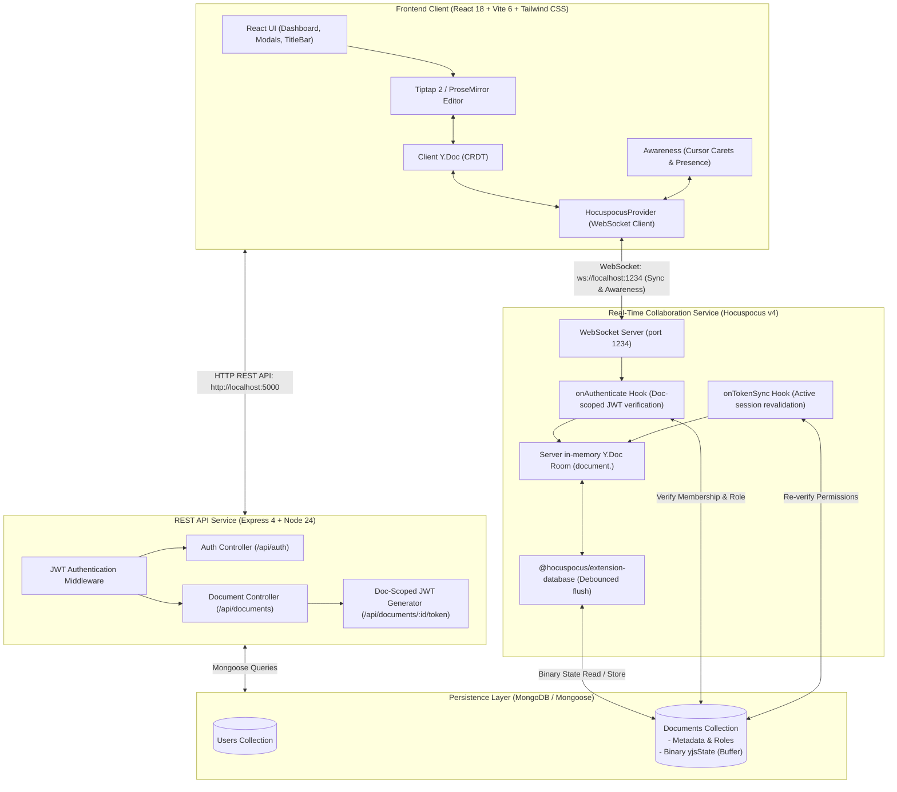

# CollabSpace

**A learning project for real-time collaborative editing.** CollabSpace is a web application where multiple users can edit the same rich-text document, see each other's cursors, and share documents with different permission levels.

The project is built to explore real-time synchronization and conflict resolution using **Yjs CRDTs** and **Hocuspocus WebSockets**, alongside a React frontend, an Express API, and MongoDB persistence.

> This is a learning and portfolio project focused on understanding real-time collaboration, synchronization, and conflict resolution.

## Features

- **Collaborative rich-text editing** with Tiptap and ProseMirror.
- **CRDT-based synchronization** with Yjs, so concurrent edits can be merged across connected clients.
- **Live awareness** with collaborator names, colored carets, selections, and an active-collaborator list.
- **Document dashboard** to create, browse, search, and delete documents.
- **Document sharing** through public links and collaborator invitations.
- **Roles and permissions** for owners, editors, and viewers.
- **Shared document titles** synchronized through Yjs metadata.
- **Persistence and recovery** using MongoDB to store document metadata and binary Yjs state.
- **Automated tests** covering core API behavior, synchronization, permissions, presence, and browser collaboration flows.

## Tech Stack

| Area | Technologies | What they do |
|---|---|---|
| Frontend | React, TypeScript, Vite, Tailwind CSS | UI and client-side application |
| Rich-text editor | Tiptap, ProseMirror | Editing and formatting documents |
| Synchronization | Yjs, Hocuspocus Provider, WebSockets | Sharing document updates and awareness |
| Backend | Node.js, Express, Hocuspocus | REST API and real-time collaboration server |
| Authentication | JWT, bcryptjs | User sessions and password hashing |
| Database | MongoDB, Mongoose | Users, document metadata, permissions, and saved Yjs state |
| Testing | Vitest, Supertest, Playwright | Unit, API integration, and browser end-to-end tests |

## Architecture Overview



### Update Lifecycle (Two Collaborators)

```text
User A keystroke
  → Tiptap ProseMirror transaction
  → Yjs XmlFragment delta update
  → HocuspocusProvider sends a binary sync update over WebSocket
  → Hocuspocus server validates the document-scoped token and permissions
  → Server in-memory Y.Doc applies the update
  → Server broadcasts the update to other peers in room `document.<id>`
  → User B's Y.Doc applies the CRDT update
  → ProseMirror renders the remote change
  → The database extension persists the Yjs state to MongoDB
```

## Run Locally

### Prerequisites

- Node.js 24 (the project is configured for Node 24; Hocuspocus v4 requires Node.js 22 or newer)
- npm
- MongoDB locally or a MongoDB Atlas connection string

Check your Node.js version:

```bash
node -v
```

### 1. Clone and install

```bash
git clone <your-repository-url> collabspace
cd collabspace
npm install
```

### 2. Create environment files

Copy the example files:

**Windows PowerShell**

```powershell
Copy-Item server/.env.example server/.env
Copy-Item client/.env.example client/.env
```

**macOS/Linux/Git Bash**

```bash
cp server/.env.example server/.env
cp client/.env.example client/.env
```

Check the example files and update the values for your machine. A typical local configuration looks like this:

`server/.env`:

```ini
NODE_ENV=development
PORT=5000
COLLAB_PORT=1234
MONGODB_URI=mongodb://127.0.0.1:27017/collabspace
JWT_SECRET=replace-with-a-long-random-local-development-secret
JWT_EXPIRY_HOURS=24
DOC_TOKEN_EXPIRY_SECONDS=3600
CLIENT_URL=http://localhost:5173
```

`client/.env`:

```ini
VITE_API_URL=http://localhost:5000/api
VITE_COLLAB_WS_URL=ws://localhost:1234
```

Use the variable names and required values from the checked-in `.env.example` files if they differ. Never commit `.env` files or real credentials. Values beginning with `VITE_` are included in the browser bundle, so they must not contain secrets.

### 3. Start the application

```bash
npm run dev
```

The local development services are expected at:

- Frontend: [http://localhost:5173](http://localhost:5173)
- REST API health check: [http://localhost:5000/api/health](http://localhost:5000/api/health)
- Hocuspocus WebSocket: `ws://localhost:1234`

Keep the terminal running while using the application. If startup fails, check your environment variables, MongoDB connection, and terminal output.

## Try Collaboration with Two Users

1. Open [http://localhost:5173](http://localhost:5173) in your normal browser and register an account.
2. Create a document and open its **Share** dialog.
3. Enable public link sharing or invite another registered user. For a first test, choose **Editor** access.
4. Open an incognito/private window, register or sign in as a different user, and open the shared link.
5. Type in both windows. Confirm the text appears in both editors.
6. Move the cursor or select text. Check whether the other user's colored caret, name label, and avatar appear.
7. Change the share role to **Viewer** and verify the other user can no longer edit.
8. Close one window and check that the disconnected collaborator disappears from the list.

If collaboration fails, check the browser Developer Tools console and Network tab for REST errors or a failed WebSocket connection.

## Run Tests

Run the unit and integration tests:

```bash
npm test
```

Run the Playwright browser tests:

```bash
npm run test:e2e
```

Run TypeScript checks:

```bash
npm run --workspace=client type-check
npm run --workspace=server type-check
```

Build the application:

```bash
npm run build
```

The test suites cover CRDT convergence, authentication, document permissions, persistence, editor synchronization, presence, and multi-browser collaboration. The Playwright tests start test services and may need the development servers stopped first if they use the same local ports.

## What I Learned / What This Project Explores

This project is a practical way to explore:

- How CRDTs help multiple clients merge concurrent document updates.
- How WebSockets differ from request/response REST APIs.
- How a shared editor, server-side authorization, and persistence fit together.
- How presence and cursor positions are synchronized separately from document content.
- How to test collaboration across independent browser sessions.

## Known Limitations

- The collaboration service keeps active document rooms in memory; multi-instance scaling needs additional coordination and testing.
- This project has not been independently security-audited or validated for production workloads.

---

Built as a learning and portfolio project to explore real-time systems, collaborative editing, and concurrency.
