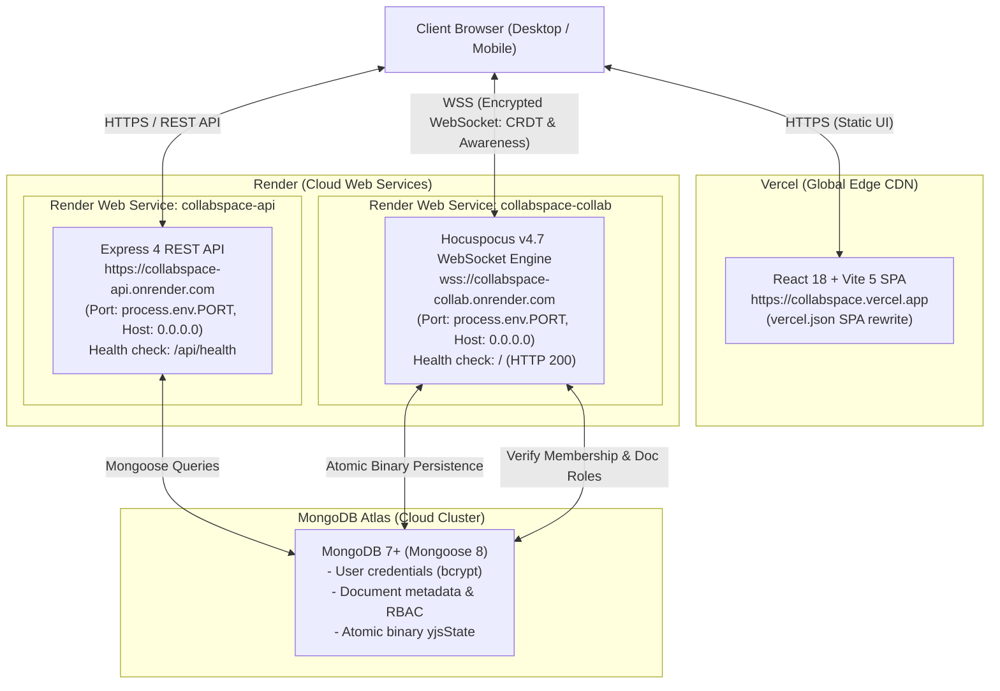

# CollabSpace — Phase 8 Verified Deployment Plan & Checklist

This document contains the verified production deployment architecture, applied code adjustments, test verification results, and step-by-step deployment instructions for hosting CollabSpace on **Vercel**, **Render**, and **MongoDB Atlas**.

---

## 1. Verified Architecture

---

## 2. Summary of Applied Code Adjustments

| Component | File | Applied Change | Verified Behavior |
| :--- | :--- | :--- | :--- |
| **Collab Server** | `server/src/collab.ts` | Binds to `process.env.PORT` if set and `0.0.0.0` in production | Runs on port 1234 in dev, binds to Render's container port in cloud |
| **Collab Server Config** | `server/src/collaboration/server.ts` | Added `address?: string` to `CreateCollabServerOptions` and configuration | Supports explicit host interface binding |
| **WebSocket Auth** | `server/src/collaboration/auth.ts` | Added origin verification checking `CLIENT_URL` in production mode | Drops unauthorized cross-origin WebSockets; allows valid origins and test environments |
| **REST API Server** | `server/src/api.ts` | Binds to `process.env.PORT` and `0.0.0.0` in production; supports comma-separated `CLIENT_URL` | Clean CORS handling for multiple production and staging domains |
| **Error Handling** | `server/src/api/middlewares/errorMiddleware.ts` | Added handler for CORS origin rejection | Returns `403 Forbidden` with descriptive message |
| **Client Hook** | `client/src/hooks/useCollaboration.ts` | Added `normalizeWsUrl` helper | Converts `https://` to `wss://` and upgrades insecure WebSocket URLs on HTTPS pages |
| **Vercel SPA Config** | `client/vercel.json` | Added rewrite `{ "source": "/(.*)", "destination": "/index.html" }` | Handles deep URLs and direct browser reloads on Vercel |
| **Render Blueprint** | `render.yaml` | Infrastructure-as-code for both Render web services with shared secrets | Synchronizes `JWT_SECRET` and `MONGODB_URI` securely |

---

## 3. Test & Build Verification Results

| Suite | Command | Result | Notes |
| :--- | :--- | :---: | :--- |
| **TypeScript Types (Client)** | `npm run --workspace=client type-check` | **PASSED** (0 errors) | `tsc --noEmit` verified |
| **TypeScript Types (Server)** | `npm run --workspace=server type-check` | **PASSED** (0 errors) | `tsc --noEmit` verified |
| **Production Build (Client)** | `npm run build --workspace=client` | **PASSED** (0 errors) | Compiled Vite static bundle (`dist/`) |
| **Production Build (Server)** | `npm run build --workspace=server` | **PASSED** (0 errors) | Compiled TypeScript to CommonJS/ESM (`dist/`) |
| **Vitest Unit & Integration** | `npm test` | **45 / 45 PASSED** | Includes new health check & origin security tests |
| **Playwright Multi-Browser E2E** | `npm run test:e2e` | **5 / 5 SUITES PASSED** | Multi-browser concurrent editing, cursors, presence, formatting, restart persistence |

---

## 4. Required Environment Variables Reference

### A. Vercel (`client`)
- `VITE_API_URL`: `https://<api-service-name>.onrender.com`
- `VITE_COLLAB_WS_URL`: `wss://<collab-service-name>.onrender.com`

### B. Render REST API (`collabspace-api`)
- `NODE_ENV`: `production`
- `PORT`: *(Auto-assigned by Render, e.g. 10000)*
- `MONGODB_URI`: `mongodb+srv://<user>:<password>@cluster0.abcde.mongodb.net/collabspace?retryWrites=true&w=majority`
- `JWT_SECRET`: `<64-character-random-hex-string>`
- `JWT_EXPIRY_HOURS`: `24`
- `DOC_TOKEN_EXPIRY_SECONDS`: `3600`
- `CLIENT_URL`: `https://<your-project>.vercel.app`

### C. Render Collaboration Server (`collabspace-collab`)
- `NODE_ENV`: `production`
- `PORT`: *(Auto-assigned by Render, e.g. 10000)*
- `MONGODB_URI`: `<identical-to-api-mongodb-uri>`
- `JWT_SECRET`: `<strictly-identical-to-api-jwt-secret>`
- `DOC_TOKEN_EXPIRY_SECONDS`: `3600`
- `CLIENT_URL`: `https://<your-project>.vercel.app`

---

## 5. Ready-to-Follow Deployment Checklist

### Step 1: MongoDB Atlas
- [ ] Create an M0 free tier or dedicated cluster in MongoDB Atlas.
- [ ] Create a dedicated database user (e.g. `collab_admin`) with a strong, random password.
- [ ] Add `0.0.0.0/0` under Network Access (required due to Render Free Tier dynamic outbound IP pools; see security note in README).
- [ ] Copy the Node.js connection string.

### Step 2: Render Deployment
- [ ] In Render, click **New > Blueprint** and select your repository.
- [ ] When prompted:
  - Enter your `MONGODB_URI`.
  - Enter your anticipated Vercel `CLIENT_URL` (e.g. `https://collabspace.vercel.app`).
- [ ] Verify that Render auto-generates `JWT_SECRET` for the API and shares it with the Collaboration service.
- [ ] Click **Apply** to build and start both services.
- [ ] Verify health endpoints:
  - API: `https://<api-service>.onrender.com/api/health` -> `{"status":"ok"}`
  - Collab: `https://<collab-service>.onrender.com/` -> `200 OK`

### Step 3: Vercel Deployment
- [ ] In Vercel, click **Add New > Project** and import the repository.
- [ ] Set **Root Directory** to `client`.
- [ ] Framework preset: `Vite`.
- [ ] Add Environment Variables:
  - `VITE_API_URL`: `https://<api-service>.onrender.com`
  - `VITE_COLLAB_WS_URL`: `wss://<collab-service>.onrender.com`
- [ ] Click **Deploy**.
- [ ] Once deployed, ensure `CLIENT_URL` on Render matches the exact live Vercel domain.
